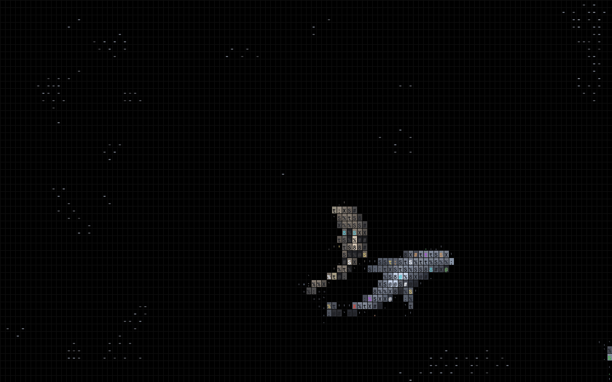
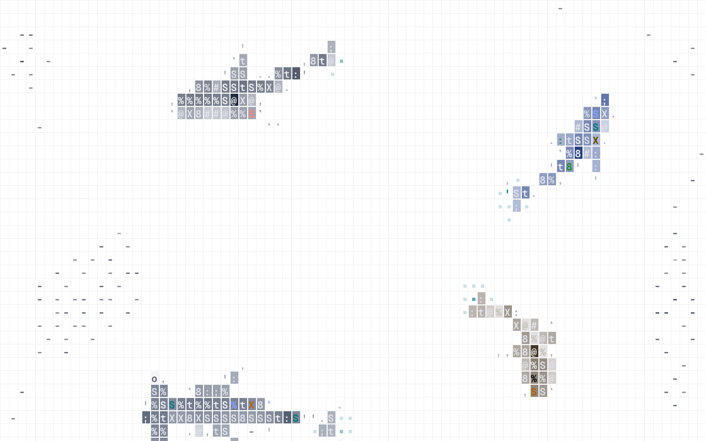
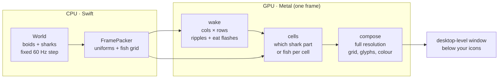

<p align="center">
  
</p>

<h1 align="center">ASCII Sharks · Wallpaper</h1>

<p align="center">
  <b>A live macOS wallpaper of sharks hunting schools of fish, drawn in ASCII.</b><br>
  It runs natively behind your desktop icons.
</p>

<p align="center">
  
  
  
  
  
</p>

<p align="center">
  
</p>

> [!NOTE]
> **This is a port.** The ocean is **[ascii-sharks](https://github.com/stackedlol/ascii-sharks)** by
> **[@stackedlol](https://github.com/stackedlol)** (drewdi): the boids, the hunting sharks, the eight species and the whole ASCII look.
> This repo brings it to the Mac as a native live wallpaper. Go star the original. ⭐

---

## Looks

<table>
  <tr>
    <td align="center"><br><sub><b>Dark</b>, the original look</sub></td>
    <td align="center"><br><sub><b>Light</b>, or match the system</sub></td>
    <td align="center"><br><sub><b>Calm</b>, easier on your icons</sub></td>
  </tr>
</table>

## Why it's nice to live with

<table>
  <tr>
    <td width="50%" valign="top">

**🖥 A real wallpaper**<br>
It sits above the system wallpaper and below your icons, on every Space. It fades in, and keeps swimming when displays change.

**🌊 One ocean across your displays**<br>
With a second monitor, the screens join into one ocean: sharks patrol a screen each and now and then swim across to the next one. Gaps between screens, and the space beside offset ones, count as walls.

**🔋 Gentle on the battery**<br>
It pauses when covered, locked, asleep or behind the screensaver. On battery or when the Mac is hot, it runs at 15 fps. In Low Power Mode it holds a still frame unless you turn animation on.

**🖱 Plays with your pointer**<br>
Fish flee the cursor and leave a wake. Click bare desktop for a splash, and the click still reaches Finder.

</td>
    <td width="50%" valign="top">

**🔒 Matches the lock screen**<br>
While it runs, a matching still becomes the system wallpaper, so the lock screen, Mission Control and the menu bar tint all match. **Your own wallpaper comes back when you quit.**

**🦈 Make the ocean yours**<br>
Pick 1–8 sharks from eight species (classic, hammerhead, great hammerhead, tiger, zebra, mako, thresher, nurse). You can also change the fish density, speed, appearance, grid, wake colour and frame rate.

**⚡️ Native**<br>
The simulation is in Swift and the renderer is a three-pass Metal renderer. There's no WebKit and no Electron. Universal binary.

</td>
  </tr>
</table>

## Install

**Download:** grab **[ASCII-Sharks.dmg](https://github.com/zegrt/ascii-sharks-wallpaper/releases/latest/download/ASCII-Sharks.dmg)** (1.4 MB, universal, macOS 14+) and drag the app to Applications.
The app isn't signed by a registered Apple developer, so the first time you open it, go to **System Settings → Privacy & Security** and click **Open Anyway**.

**Or build it yourself.** The only requirement is Apple's Command Line Tools (`xcode-select --install`). You don't need Xcode.

```sh
git clone https://github.com/zegrt/ascii-sharks-wallpaper
cd ascii-sharks-wallpaper
Tools/build.sh      # runs the checks, builds a universal app, renders its icon
Tools/install.sh    # copies it to ~/Applications and launches it
```

Then find the 🐟 in the menu bar for **Pause**, **Sharks**, **Appearance**, **Settings…** (`⌘,`), **Restore Original Wallpaper** and **Open at Login**.

## How it works



| Layer | Folder | What it does |
|---|---|---|
| **Domain** | `Sources/OceanKit/Domain` | The simulation, settings, power policy, pointer routing, frame packing and wallpaper bookkeeping. Pure Swift with no AppKit, and fully checked. |
| **Render** | `Sources/OceanKit/Render` | The MSL shaders (compiled at runtime), the Geist Mono glyph atlas and offscreen stills. |
| **Host** | `Sources/ASCIISharks` | AppKit: windows, display links, system signals, the menu, settings and the system wallpaper. |

The ocean is rendered on a grid of ASCII cells. Each frame:
1. The **wake** pass diffuses ripples, once per simulation step, so trails don't depend on the frame rate.
2. The **cells** pass decides what fills each cell: shark body, fin, ridge, eye or markings, or a fish.
3. The **compose** pass draws the grid, wake dots, eat flashes and the glyphs from a font atlas.

## Energy

Measured on an M5 Pro MacBook Pro.

| | App | WindowServer added | Memory |
|---|---|---|---|
| **15 fps** (on battery) | ~2.5% CPU | within noise | ~84 MB |
| **30 fps** (on AC, the default) | ~4–5.5% CPU | ~15% | ~84 MB |
| *WebKit prototype, for comparison* | *~14% CPU* | *not measured* | *~355 MB* |

Most of a live wallpaper's cost is WindowServer redrawing everything above it on every frame. That's why the frame rate is the main lever, and why the economy rate is 15 fps.

## Develop

```sh
swift run -c release OceanChecks                       # 71 checks: domain + headless Metal renders
swift run -c release OceanTool still out.png 1440x900  # --light --calm --sharks mako,tiger --seed 3
swift run -c release OceanTool frames out/ 1080x675    # a continuous run as PNG frames
swift run -c release OceanTool bench                   # simulation cost
OCEAN_DEBUG=1 .build/out/Products/Release/ASCIISharks  # log power-mode decisions
```

The design and its review are in [`docs/plans/`](docs/plans).

## Limits

- **Spaces:** macOS changes wallpapers one Space at a time and gives apps no way to identify Spaces. So the matching still goes on the Space where the app starts. Wallpapers it doesn't recognise are never touched, and only what it set is restored.
- **Aerial and dynamic wallpapers:** these come back as whatever image macOS reports for them.
- **Signing:** the app is signed ad hoc, not by a registered Apple developer. That's why macOS asks you to click Open Anyway the first time you open it.
- **On the list:** a screensaver edition.

## Credits

- **The ocean:** [ascii-sharks](https://github.com/stackedlol/ascii-sharks) by [@stackedlol](https://github.com/stackedlol) (drewdi), MIT. The simulation, species, shark shapes and rendering style are ported from it.
- **Font:** [Geist Mono](https://github.com/vercel/geist-font), SIL Open Font License 1.1 ([`Resources/OFL.txt`](Resources/OFL.txt)).
- **License:** MIT ([`LICENSE`](LICENSE)). It keeps the original copyright notice alongside this port's.

<p align="center"><sub>
<pre>
       ;'                .oooo
        %%'    .t;.       %8S8.
  t'   ''XSSS8SSX%XX8#.   %XSX%      ~ swim safe ~
   ::%t%%%S%:;StS%ttSS%tSXSt88@@%8%
</pre>
</sub></p>
