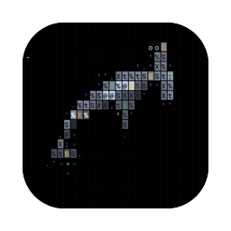
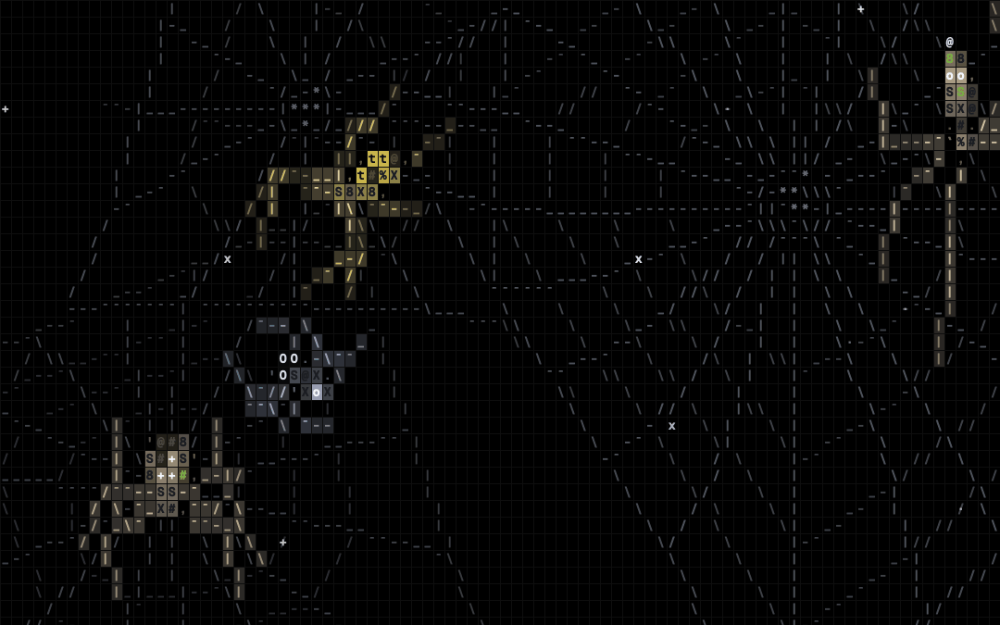
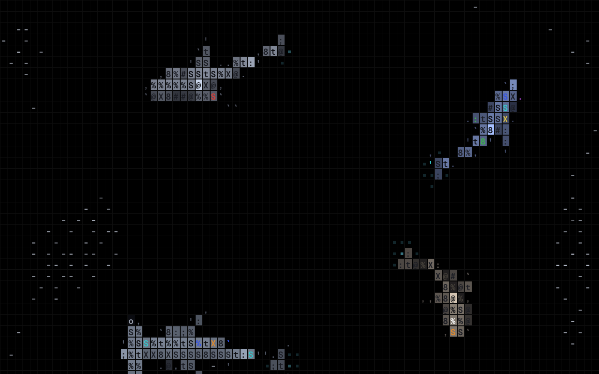
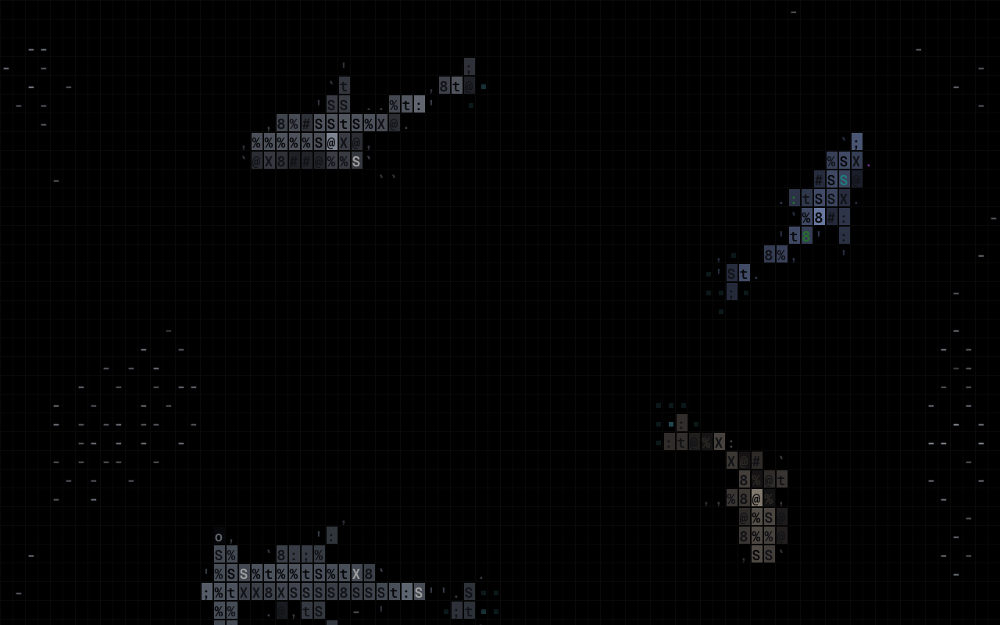
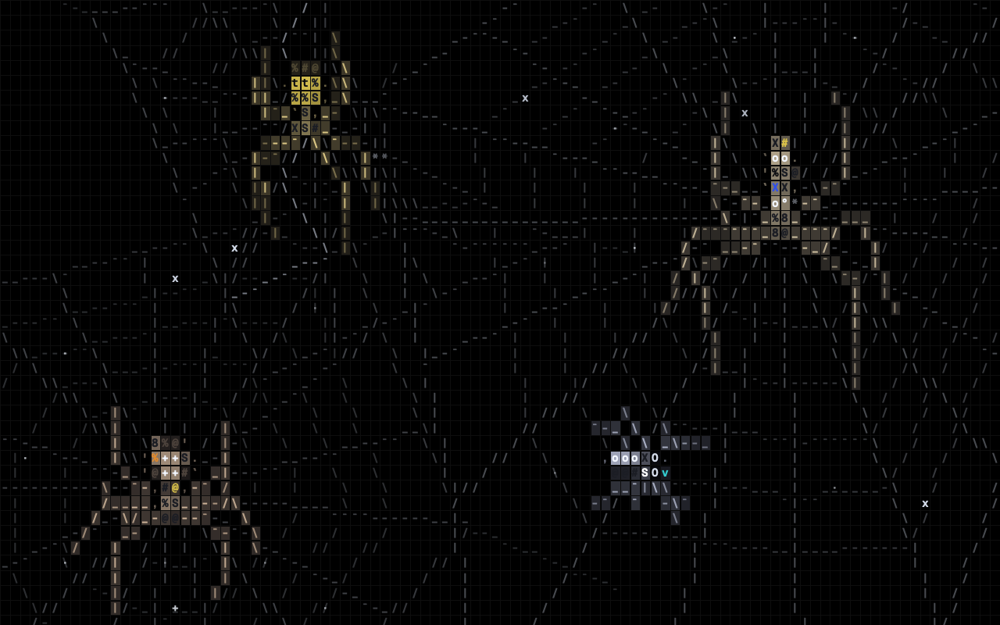
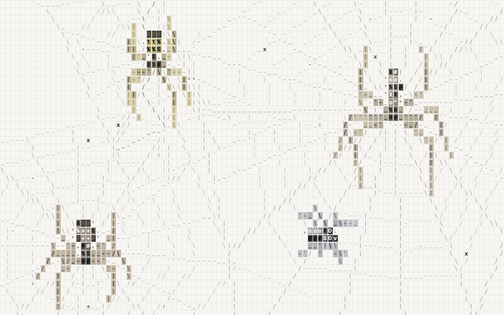
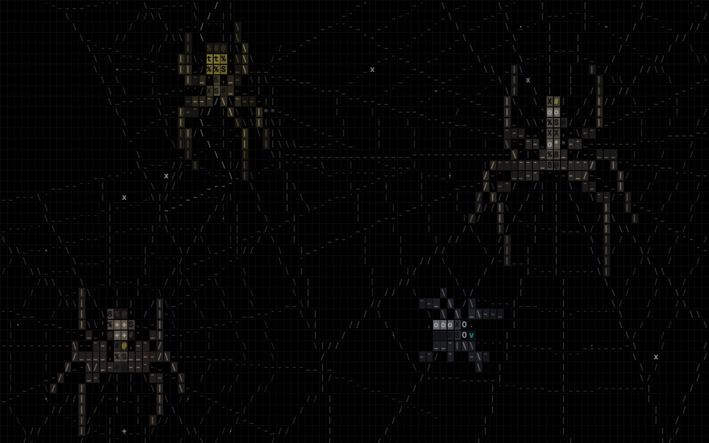
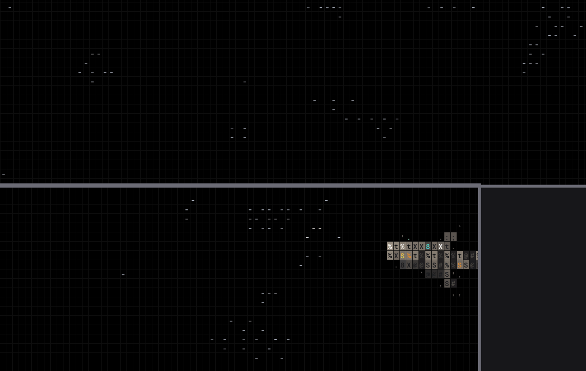

  

<h1 align="center">ASCII Animals</h1>

  <b>Sharks hunting schools of fish, or spiders spinning their webs, right on your Mac's desktop, all drawn in letters and symbols.</b> 
  A living wallpaper that moves quietly behind your icons.

   
  macOS 14 or later · Apple Silicon and Intel

<table align="center">
  <tr>
    <td align="center"> <b>The Ocean</b></td>
    <td align="center"> <b>The Web</b></td>
  </tr>
</table>

## Get it in a minute

1. **[Download ASCII Animals](https://github.com/zegrt/ascii-animals/releases/latest/download/ASCII-Animals.dmg)**, open it, and drag the app into **Applications**.
2. **Open it.** macOS will stop it the first time, because it isn't from a registered Apple developer. Go to **System Settings → Privacy & Security**, scroll down and click **Open Anyway**. You only do this once.
3. **That's it.** Sharks are swimming on your desktop, and a little 🐟 sits in your menu bar. Pick the Web there whenever you like.

**Already using ASCII Sharks?** Just install this one. It takes over: it quits ASCII Sharks, keeps your settings, and offers to move ASCII Sharks to the Trash.

## Things to try

- 🕸 **Pick a habitat.** The **Ocean**, with sharks and fish, or the **Web**, with spiders spinning orb webs, flies wandering by and a jumping spider on the hunt.
- 🖱 **Move your mouse** over the desktop. Fish scatter and leave a ripple; spider silk rings as you pass through it.
- 💦 **Click empty desktop.** In the Ocean, a splash. In the Web, a fly drops in, and if it lands in a web, the spider comes for it.
- 🕷 **Hold the pointer still** near the jumping spider. It may pounce.
- 🦈 **Choose your animals.** Up to eight sharks from eight species (hammerhead, tiger, mako, thresher and more), or a line-up of spiders: the classic six, or all garden spiders, wasp spiders or golden orb weavers.
- 🌗 **Dark, Light or Calm.** Calm is dimmer, so your desktop icons stand out.
- 🖥 **Two screens?** They join into one habitat, and animals move from one to the other.
- ⏸ **⌃⌥⌘P** pauses it from anywhere.

It's all in the 🐟 menu and in **Settings**.

<table>
  <tr>
    <td align="center"> <b>Dark</b></td>
    <td align="center"> <b>Light</b></td>
    <td align="center"> <b>Calm</b></td>
  </tr>
  <tr>
    <td align="center"> <b>Dark</b></td>
    <td align="center"> <b>Light</b></td>
    <td align="center"> <b>Calm</b></td>
  </tr>
</table>

  

## Good to know

- **Easy on your battery.** It stops when the desktop is covered or your Mac is locked or asleep. It slows down on battery and holds still in Low Power Mode. The Web costs no more than the Ocean.
- **Your lock screen matches.** While it runs, a still of your habitat becomes your wallpaper too. Quit, and your own wallpaper comes back.
- **It keeps itself up to date.** New versions install themselves in a second or two. Rather choose when? Turn that off in Settings.
- **Private.** No accounts, no ads, no tracking. The only thing it ever asks the internet is "is there a new version?"
- **Easy to remove.** 🐟 menu → Help → **Uninstall ASCII Animals…** puts your wallpaper back and deletes everything it saved.

<b>Privacy, in detail</b>

- **The one network request:** about once a day, the app asks GitHub for the latest version of this project. It sends the app's version and nothing else. When there's an update, it downloads it from GitHub. You can turn checking off in Settings.
- **The pointer and windows:** it notices where your pointer is and where windows sit, only so the animals can react and so it can pause when the desktop is covered. It can't see what you type or what's inside your windows, and it needs no special permissions.
- **Problem reports:** logs stay on your Mac (`~/Library/Logs/ASCII Animals`). **Report a Problem** opens a draft on GitHub with your name and folders removed, and nothing is sent until you submit it.

## Thanks

ASCII Animals brings two projects by **[@stackedlol](https://github.com/stackedlol)** to the Mac as a wallpaper. The Ocean comes from **[ascii-sharks](https://github.com/stackedlol/ascii-sharks)**: the sharks, the fish and the whole ASCII look. The Web comes from **[ascii-spiders](https://github.com/stackedlol/ascii-spiders)**: the spiders, their webs, the flies and the jumper. Go give them a ⭐.

Made by [XERO WORKS](https://xeroworks.org). Set in [Geist Mono](https://github.com/vercel/geist-font). MIT licensed ([`LICENSE`](LICENSE)), keeping both originals' copyright notices.

Curious how it's built, or want to build it yourself? See **[docs/DEVELOPING.md](docs/DEVELOPING.md)**.

<pre>
       ;'                .oooo
        %%'    .t;.       %8S8.
  t'   ''XSSS8SSX%XX8#.   %XSX%      ~ swim safe ~
   ::%t%%%S%:;StS%ttSS%tSXSt88@@%8%
</pre>

