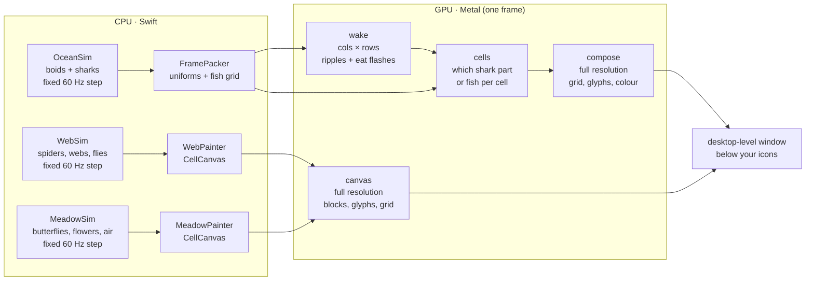

# Developing ASCII Animals

## Build it yourself

The only requirement is Apple's Command Line Tools (`xcode-select --install`). You don't need Xcode.

```sh
git clone https://github.com/zegrt/ascii-animals
cd ascii-animals
Tools/build.sh      # runs the checks, builds a universal app
Tools/install.sh    # copies it to ~/Applications and launches it
Tools/package.sh    # the DMG (for people) and the zip (for self-updates)
```

Push a tag like `v3.1` that matches `Info.plist` and a `CHANGELOG.md` section, and the Release workflow builds and publishes both.

## Tools

```sh
swift run -c release OceanChecks                       # domain checks + headless Metal renders
swift run -c release OceanTool still out.png 1440x900  # --habitat web|meadow --light --calm --sharks mako,tiger --seed 3
swift run -c release OceanTool frames out/ 1080x675    # a continuous run as PNG frames (--habitat web --interact: with the pointer)
swift run -c release OceanTool bench                   # simulation cost
swift run -c release OceanTool bench --desk --habitat web  # CPU per second on a two-screen desk, 30 and 15 fps
swift run -c release OceanTool bench --digest          # fingerprint of the Web's canvases: same digest, same output
OCEAN_DEBUG=1 .build/release/ASCIIAnimals             # log power-mode decisions
```

## How it works

Each **habitat** is a `HabitatSim`: the **Ocean** (`OceanSim`, sharks and boids), the **Web** (`WebSim`, the port of ascii-spiders) or the **Meadow** (`MeadowSim`, butterflies and flowers, our own). The host drives whichever one is chosen the same way: a fixed 60 Hz step, the pointer and clicks, a layout across your displays, and a settled still for the system wallpaper. Switching habitats dissolves one into the other.



| Layer | Folder | What it does |
|---|---|---|
| **Domain** | `Sources/OceanKit/Domain` | The habitats' shared protocol (`HabitatSim`), the Ocean's simulation, settings, power policy, pointer routing, frame packing, the hand-over from ASCII Sharks, wallpaper bookkeeping and update rules. Pure Swift with no AppKit, and fully checked. |
| **Web** | `Sources/OceanKit/Web` | A faithful port of [ascii-spiders](https://github.com/stackedlol/ascii-spiders) (MIT, commit 89a7721): orb webs, weavers, the jumper, flies, and the painter that draws them into a `CellCanvas`. Checked against the original's numbers. |
| **Meadow** | `Sources/OceanKit/Meadow` | The Meadow, XERO WORKS' own: the air, the flowers, the butterflies' flight and choices, and the painter that draws them into a `CellCanvas`. Ported from our sketch and checked against its numbers. |
| **Render** | `Sources/OceanKit/Render` | The MSL shaders (compiled at runtime), `CellCanvas`, the Geist Mono glyph atlas and offscreen stills. |
| **Host** | `Sources/ASCIIAnimals` | AppKit: windows, display links, system signals, the menu, settings, the system wallpaper and self-updating. |

The **Ocean** is rendered on a grid of ASCII cells. Each frame:
1. The **wake** pass diffuses ripples, once per simulation step, so trails don't depend on the frame rate.
2. The **cells** pass decides what fills each cell: shark body, fin, ridge, eye or markings, or a fish.
3. The **compose** pass draws the grid, wake dots, eat flashes and the glyphs from a font atlas.

The **Web** is drawn on the CPU, as the original draws its 2D canvas: `WebPainter` fills a `CellCanvas` (a block colour, up to two glyphs and their ink per cell), and one GPU pass, `canvas_main`, composes it at full resolution with the same glyph atlas.

The **Meadow** is drawn the same way as the Web. It was designed first as a sketch: a single web page with a slider for every number, tuned by eye ([`Tools/meadow-sketch/meadow.html`](../Tools/meadow-sketch/meadow.html)). The sketch is the Meadow's original, as ascii-spiders is the Web's: `MeadowSim` and `MeadowPainter` port it with its own random stream, so a seed grows the same meadow, and every tuned number lives in `MeadowTuning`, each with the sketch line it comes from. `OceanChecks` compares the air and the flowers against numbers the sketch itself produced (`Sources/OceanChecks/Fixtures`), and holds the rest to safety rules: finite and sane, nothing allocated per frame, the same meadow for a seed, several screens and never more than 12 butterflies across them. The look and the flight are judged by eye, on films beside the sketch.

**Web reference tooling.** [`Tools/web-reference/`](../Tools/web-reference) runs the original ascii-spiders under node with the port's seeded random stream, producing the reference numbers `OceanChecks` compares the port against, plus a side-by-side parity page for Chrome. Its README has the steps.

**Updates** come from GitHub's `releases/latest`. The app downloads `ASCII-Animals.zip` (a mounted DMG can't be read by an app without a permission prompt), checks GitHub's SHA-256, the bundle identifier and version and the code signature, then swaps itself in with one atomic rename and restarts. An automatic update waits while the app is in use (Settings open, focused or not, a menu open, the welcome or the what's-new card up) and looks again right before the swap; a failed or unreadable check is retried within the hour and never reads as "up to date"; if the new copy can't be started, the old one keeps running and says so.

## Energy

Measured on an M5 Pro MacBook Pro.

| | App | WindowServer added | Memory |
|---|---|---|---|
| **15 fps** (on battery) | ~2.5% CPU | within noise | ~84 MB |
| **30 fps** (on AC, the default) | ~4–5.5% CPU | ~15% | ~84 MB |
| *WebKit prototype, for comparison* | *~14% CPU* | *not measured* | *~355 MB* |

Most of a live wallpaper's cost is WindowServer redrawing everything above it on every frame. That's why the frame rate is the main lever, and why the economy rate is 15 fps.

**Ocean and Web, side by side.** Measured with `Tools/energy.sh` on the same Mac with two displays (the built-in Retina plus a 2560×1440 monitor, one shared habitat), 60 s per row after 10 s of settling. WindowServer with no wallpaper app running was 0.4%. Two displays cost more than the single-display table above, so compare rows here with each other.

| | App | WindowServer | Memory |
|---|---|---|---|
| Ocean, 30 fps | 12.7% CPU | 22.2% | ~285 MB |
| **Web, 30 fps** | **9.6% CPU** | 22.1% | ~230 MB (311 peak) |
| Ocean, 15 fps | 10.3% CPU | 15.6% | ~270 MB |
| **Web, 15 fps** | **8.3% CPU** | 16.2% | ~297 MB |

**All three habitats, 3.1.** Measured with `Tools/energy.sh` on 21 November 2026 on the same two displays: the built-in Retina plus the same 2560×1440 monitor, which runs at 100 Hz, so it settles at 33.3 fps when 30 is asked and 16.7 when 15 is. Plugged in, Energy Mode on Automatic, 60 s per row after 10 s of settling, 7 butterflies on the Meadow. WindowServer with no wallpaper app running was 8.9% before the runs and 6.9% after, far above the 0.4% of the session above, so compare rows here with each other.

| | App | WindowServer | Memory |
|---|---|---|---|
| Ocean, 30 fps | 11.5% CPU | 26.0% | ~243 MB |
| Web, 30 fps | 13.7% CPU | 26.3% | ~205 MB |
| **Meadow, 30 fps** | **10.7% CPU** | 29.7% | ~213 MB (215 peak) |
| Ocean, 15 fps | 8.7% CPU | 18.4% | ~243 MB |
| Web, 15 fps | 8.7% CPU | 16.8% | ~205 MB |
| **Meadow, 15 fps** | **6.2% CPU** | 19.0% | ~211 MB (215 peak) |

The Meadow costs the app the least of the three. WindowServer is about 3 points higher for it at 30 fps.

Memory here is the app's footprint as `top` reports it; most of it is the displays' frame buffers. `swift run -c release OceanTool bench --desk --habitat web` measures the CPU work per second offscreen on the same layout.

## Known limits

- **Spaces:** macOS changes wallpapers one Space at a time and gives apps no way to identify Spaces. So the matching still goes on the Space where the app starts. Wallpapers it doesn't recognise are never touched, and only what it set is restored.
- **Aerial and dynamic wallpapers** come back as whatever image macOS reports for them.
- **Signing:** the app is signed ad hoc, not with a Developer ID. That's why macOS asks for Open Anyway the first time. It also limits what a self-update can prove: the checksum comes from the same GitHub release as the download, and an ad hoc signature shows the app is intact, not who made it. So an update is as trustworthy as the GitHub repository and its releases; it is not separately authenticated as ours. Developer ID signing (or a separately signed release manifest) would close that, and is not planned for 3.1.
- **On the list:** a screensaver edition.

The design and its review are in [`plans/`](plans).
