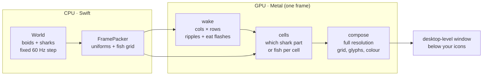

# Developing ASCII Sharks

## Build it yourself

The only requirement is Apple's Command Line Tools (`xcode-select --install`). You don't need Xcode.

```sh
git clone https://github.com/zegrt/ascii-sharks-wallpaper
cd ascii-sharks-wallpaper
Tools/build.sh      # runs the checks, builds a universal app
Tools/install.sh    # copies it to ~/Applications and launches it
Tools/package.sh    # the DMG (for people) and the zip (for self-updates)
```

Push a tag like `v2.4` that matches `Info.plist` and a `CHANGELOG.md` section, and the Release workflow builds and publishes both.

## Tools

```sh
swift run -c release OceanChecks                       # domain checks + headless Metal renders
swift run -c release OceanTool still out.png 1440x900  # --light --calm --sharks mako,tiger --seed 3
swift run -c release OceanTool frames out/ 1080x675    # a continuous run as PNG frames
swift run -c release OceanTool bench                   # simulation cost
OCEAN_DEBUG=1 .build/out/Products/Release/ASCIISharks  # log power-mode decisions
```

## How it works



| Layer | Folder | What it does |
|---|---|---|
| **Domain** | `Sources/OceanKit/Domain` | The simulation, settings, power policy, pointer routing, frame packing, wallpaper bookkeeping and update rules. Pure Swift with no AppKit, and fully checked. |
| **Render** | `Sources/OceanKit/Render` | The MSL shaders (compiled at runtime), the Geist Mono glyph atlas and offscreen stills. |
| **Host** | `Sources/ASCIISharks` | AppKit: windows, display links, system signals, the menu, settings, the system wallpaper and self-updating. |

The ocean is rendered on a grid of ASCII cells. Each frame:
1. The **wake** pass diffuses ripples, once per simulation step, so trails don't depend on the frame rate.
2. The **cells** pass decides what fills each cell: shark body, fin, ridge, eye or markings, or a fish.
3. The **compose** pass draws the grid, wake dots, eat flashes and the glyphs from a font atlas.

**Updates** come from GitHub's `releases/latest`. The app downloads `ASCII-Sharks.zip` (a mounted DMG can't be read by an app without a permission prompt), checks GitHub's SHA-256, the bundle identifier and version and the code signature, then swaps itself in with one atomic rename and restarts.

## Energy

Measured on an M5 Pro MacBook Pro.

| | App | WindowServer added | Memory |
|---|---|---|---|
| **15 fps** (on battery) | ~2.5% CPU | within noise | ~84 MB |
| **30 fps** (on AC, the default) | ~4–5.5% CPU | ~15% | ~84 MB |
| *WebKit prototype, for comparison* | *~14% CPU* | *not measured* | *~355 MB* |

Most of a live wallpaper's cost is WindowServer redrawing everything above it on every frame. That's why the frame rate is the main lever, and why the economy rate is 15 fps.

## Known limits

- **Spaces:** macOS changes wallpapers one Space at a time and gives apps no way to identify Spaces. So the matching still goes on the Space where the app starts. Wallpapers it doesn't recognise are never touched, and only what it set is restored.
- **Aerial and dynamic wallpapers** come back as whatever image macOS reports for them.
- **Signing:** the app is signed ad hoc, not with a Developer ID. That's why macOS asks for Open Anyway the first time.
- **On the list:** a screensaver edition.

The design and its review are in [`plans/`](plans).
