# The Meadow in the app (design proposal d1, 2026-11-20)

Status: a proposal for the director. Nothing is built from it until approved; m8 (presets and Settings) and t9 (menu,
welcome, what's-new) build from the approved version.

How the pictures were made: Ocean and Web as they are today come from the app's own `--snapshot-settings` and
`--snapshot-onboarding` flags (Settings for both habitats, dark and light; the welcome's first beat and "Make it
yours"; the Web card). The mock-ups are HTML pages drawn with those snapshots' colours, fonts and sizes, rendered
headless to PNG. The Meadow inside them is the tuned sketch (`meadow-sketch`) at the director's settings, rendered
headless at the same seed, because the app's Meadow is still being ported (mp).

## 1. Presets

A line-up is **which species, and how many on a laptop screen**. A bigger display gets more in proportion to its
area (the sketch's own rule: the count is for 1440 × 900, rounded, 1 to 24). The species share the count evenly; at a
fresh start an odd one goes to the first species in the list, as in the sketch. That is exactly the sketch's model (four species
on or off, plus "How many"), so the port keeps the sketch's rules for keeping the mix when butterflies come and go.

| Line-up | Butterflies on a laptop | Why |
|---|---|---|
| **Mixed** (default) | 2 Monarchs, 2 Blue Morphos, 2 Swallowtails, 1 Cabbage White | the director's tuned mix: all four, 7 |
| **Monarchs** | 6 Monarchs | one kind, as Web's "Garden Spiders" |
| **Blue Morphos** | 5 Blue Morphos | the biggest wings, so fewer |
| **Swallowtails** | 6 Swallowtails | |
| **Cabbage Whites** | 9 Cabbage Whites | the smallest and flittiest, so more |
| **Just a Few** | 1 Monarch, 1 Blue Morpho, 1 Cabbage White | a quiet desk; the Meadow has no "Fish" slider |
| Custom | anything else | appears by itself when the species or count match no line-up |

Names follow the family: plain plurals, like "Hammerheads" and "Wasp Spiders"; the default is called "Mixed", as the
Ocean's is. Species names: Monarch, Blue Morpho, Swallowtail, Cabbage White.

| Dark | Light |
|---|---|
| 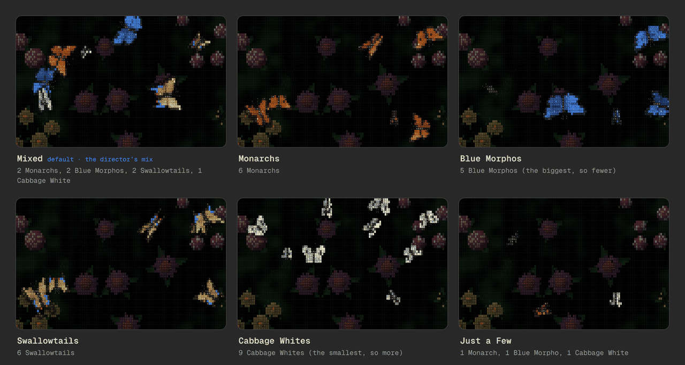 | 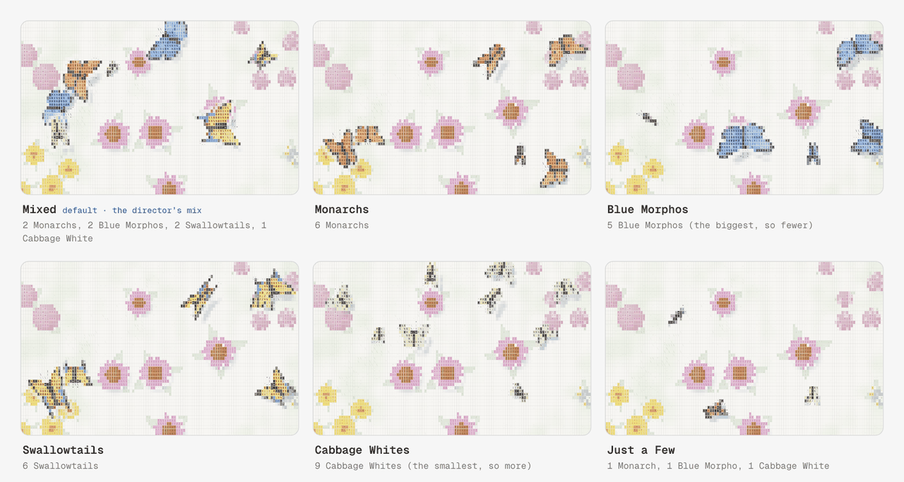 |

**Recommended:** these six. If six feels like too many, drop Swallowtails first.

## 2. The Settings section

One **Meadow** section, shaped like Web's: the "Butterflies" picker (line-ups, the summary under it), then the four
species as switches and a "How many" stepper (1–12), then Speed. Picking a line-up sets the switches and the count;
changing a switch or the count makes it "Custom". At least one species stays on (the last switch can't turn off).
The Behaviour section's "Play with the pointer" gets the Meadow's line. The Habitat picker gains a third segment; it
still fits the 270 pt width. Everything else is unchanged.

- Status: **Fluttering · 30 fps**.
- "Play with the pointer": "Butterflies veer from the pointer, and one may land on it when it's still. Clicking bare
  desktop blooms a flower." (Landing follows this switch, as the director decided.)
- Footer: "Pick a line-up, or turn species on and off for your own. At least one stays on."
- "How many": "On a laptop screen. A bigger display gets more in proportion."

| Mixed (dark) | Custom (dark) |
|---|---|
| 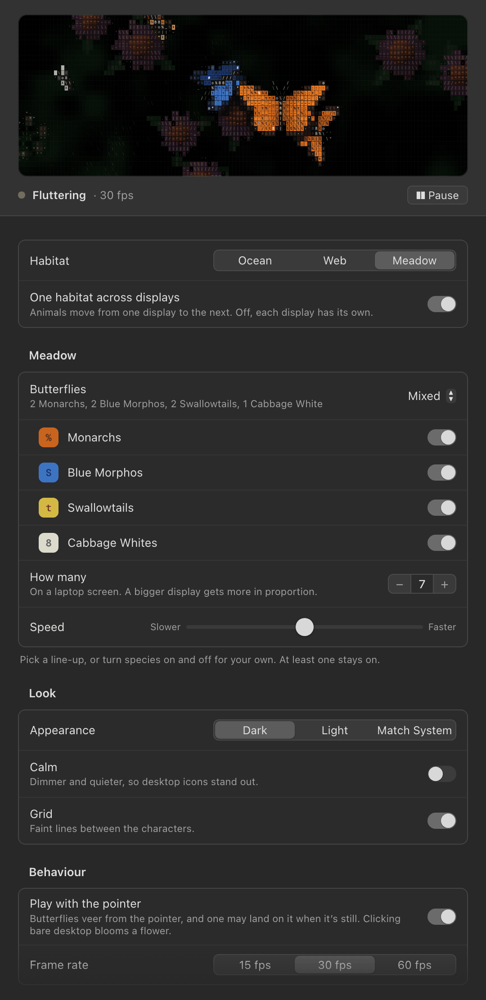 | 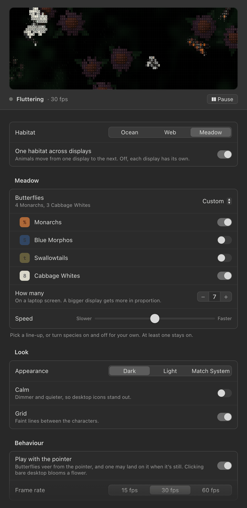 |
| **Mixed (light)** | **Custom (light)** |
| 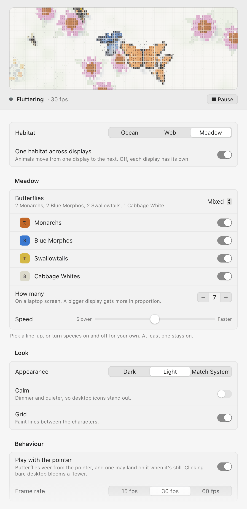 | 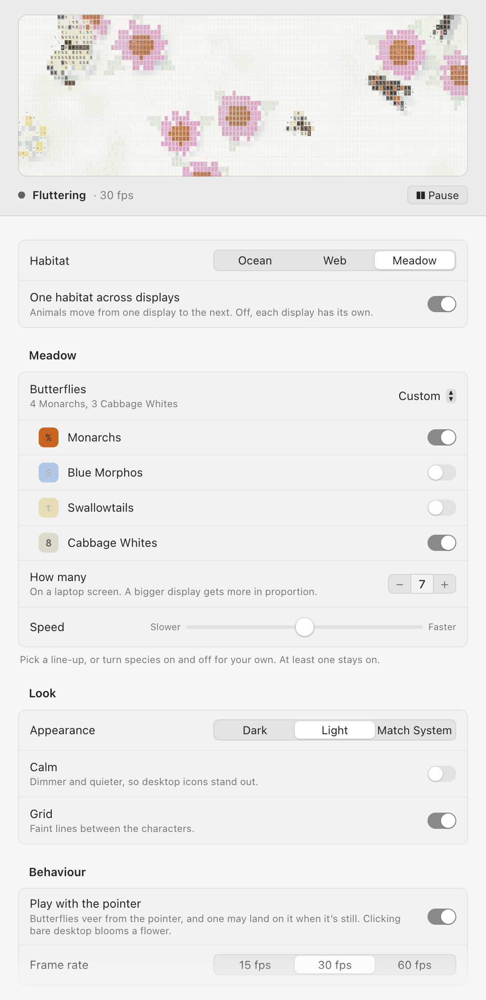 |

**Recommended:** this layout. The other way, the Ocean's per-row editor, would need per-species counts, which the
sketch doesn't have and the director didn't tune; Web's way (picker only) leaves Custom unreachable.

## 3. The menu

- **Habitat** gains **Meadow**, with a small **New** tag (macOS's own menu badge). The tag goes once the person has
  picked the Meadow, and in any case with 3.2. People who start on 3.1 never see it.
- On the Meadow, the habitat submenu is **Butterflies** (a flower symbol, `camera.macro`), shaped like Sharks:
  "Line-Ups" with the six, each with its summary and ⌘1–⌘6; "Your Line-Up" when Custom; then "Edit Line-Up…",
  which opens Settings. No per-species toggles or More/Fewer in the menu (the old plan's Task 9 had them; the line-ups
  replace them, as the director asked).
- The status line reads **Fluttering**.

| On the Ocean, before trying it | On the Meadow |
|---|---|
| 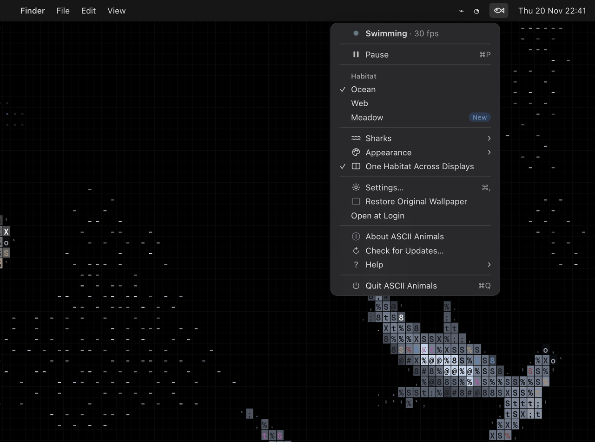 | 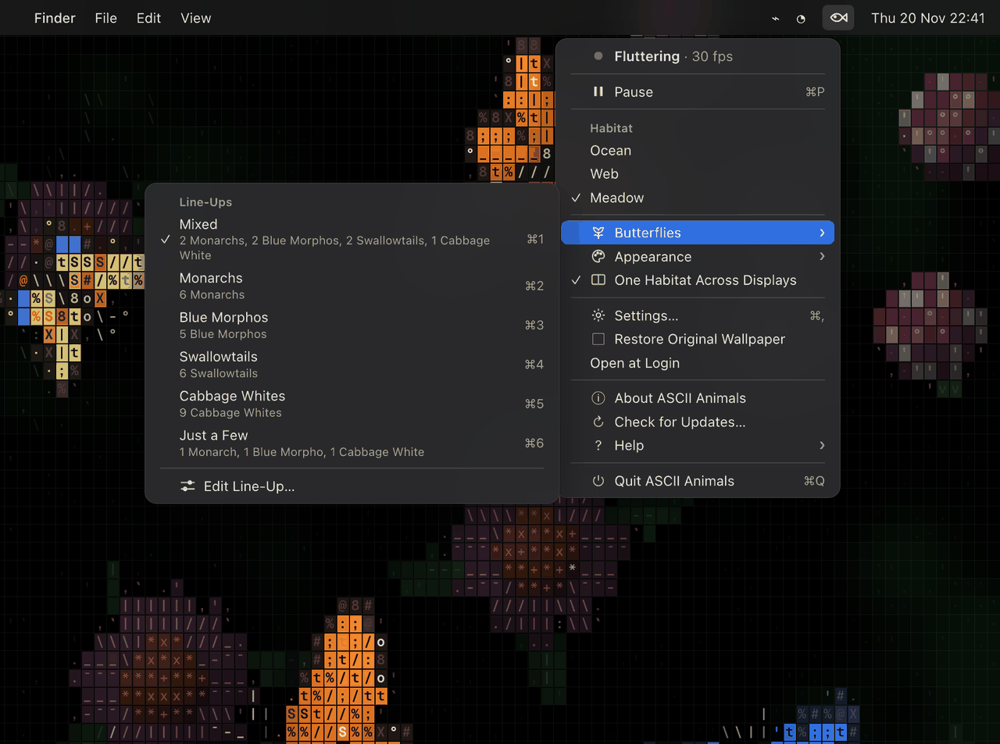 |
| 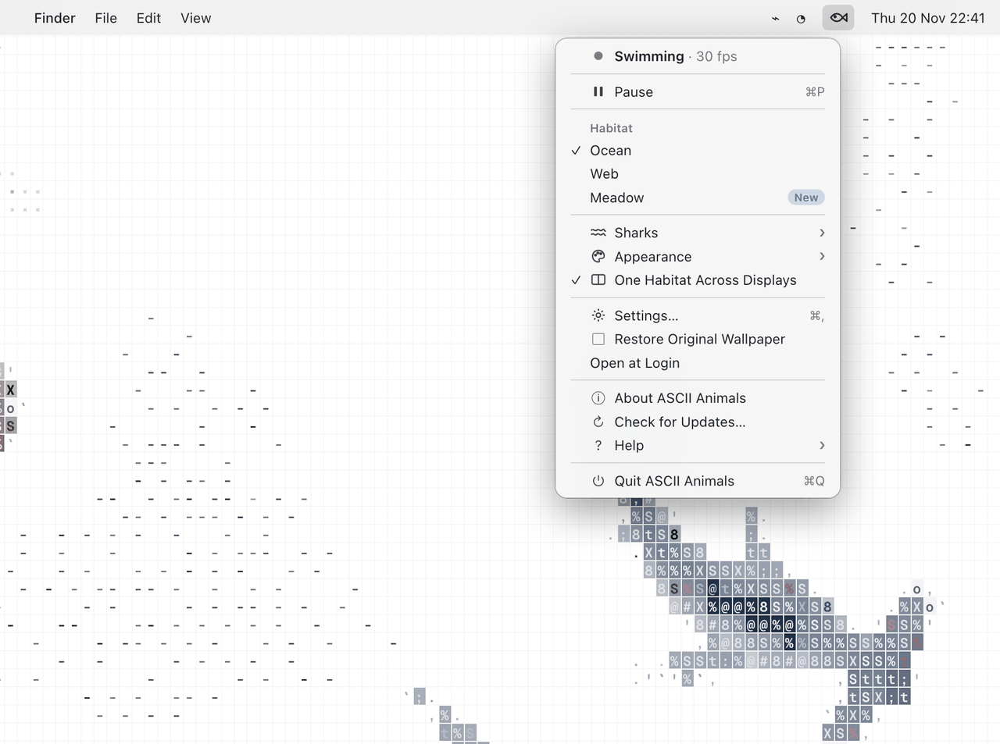 | 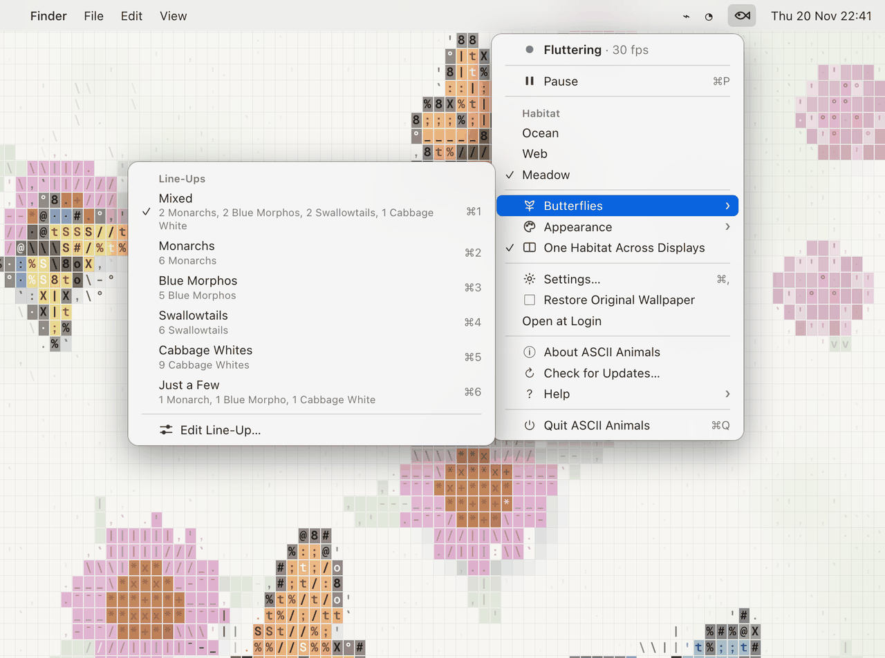 |

**Status word, recommended:** "Fluttering" (the old plan's word; "Swimming", "Weaving", "Fluttering" read as one
family).

## 4. What's new, for people updating to 3.1

Today the Web card fills the screen (below, for comparison). The director said this one doesn't need to. Three small
options; each is shown **once** (`whatsNew.meadow.v1`) to people who used the app before 3.1, never to new users, and
the "New" tag in the menu comes with all three.

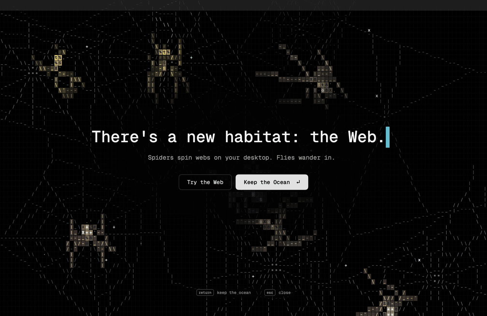

| | Dark | Light |
|---|---|---|
| **A. A system popover** under the fish: native look, like Settings | 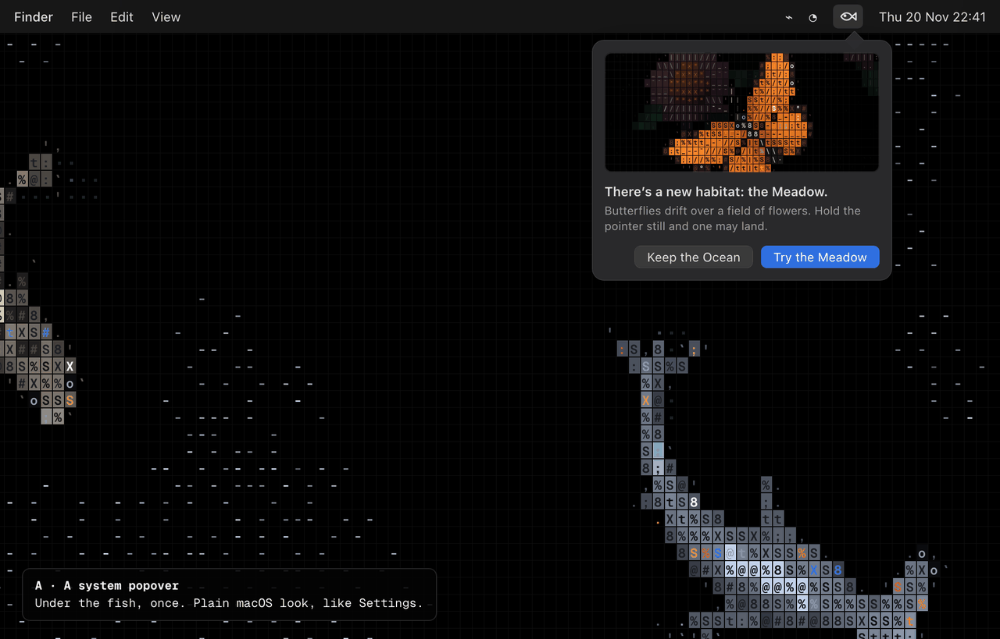 | 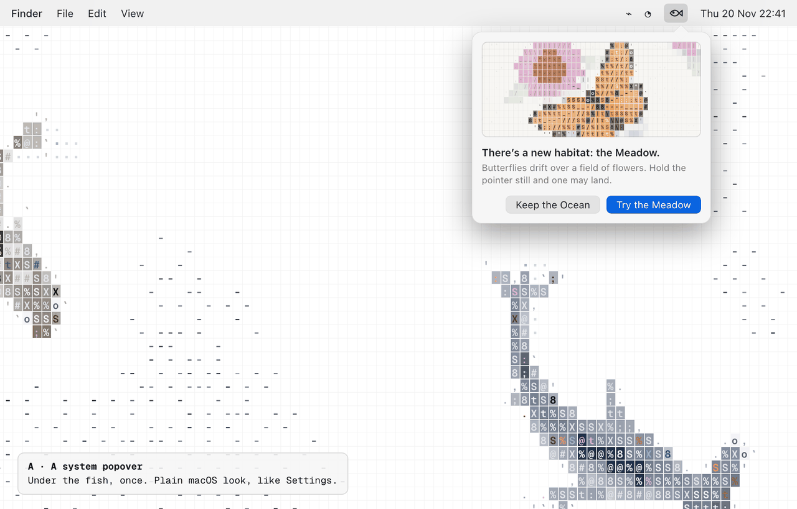 |
| **B. Only the menu:** a dot on the fish, and "Try the Meadow" at the top of the menu until it's opened | 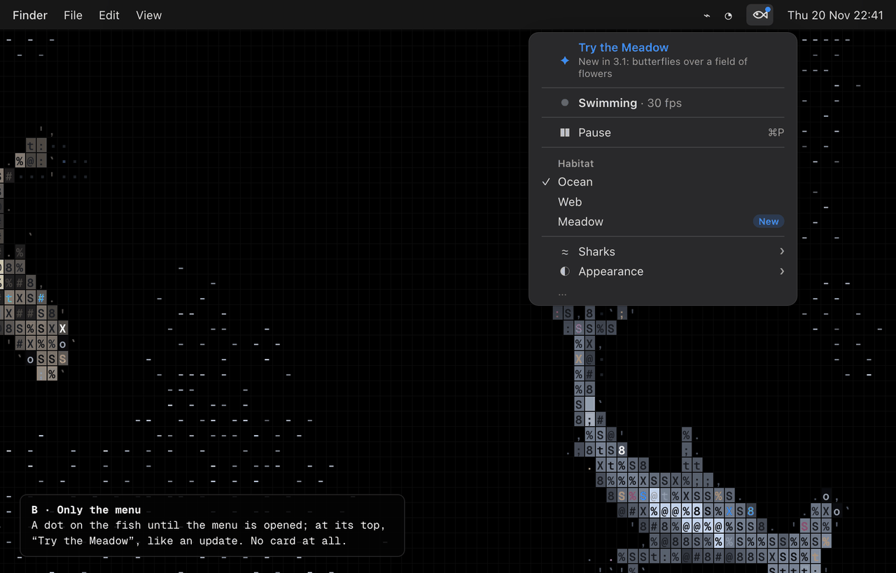 | 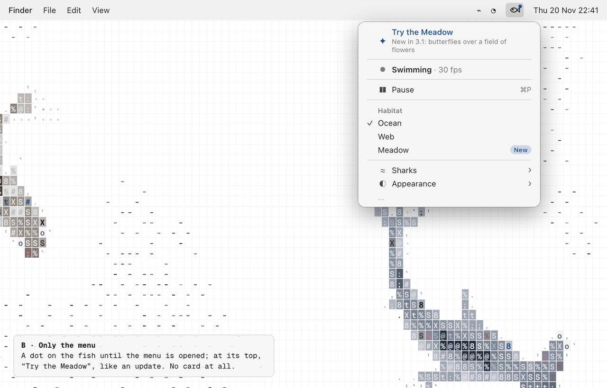 |
| **C. A small card in the welcome's voice** under the fish, with the Meadow live in it | 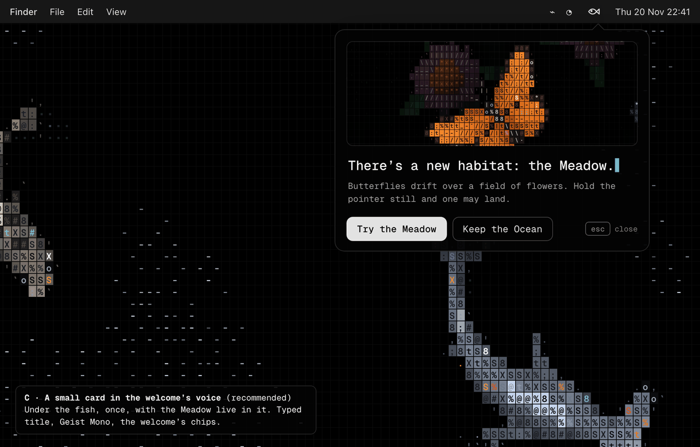 | 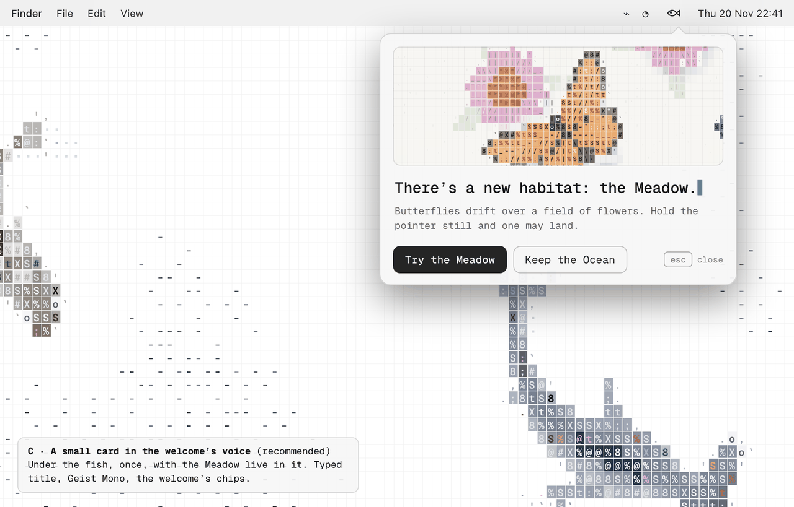 |

**Recommended: C.** It is small, it shows the butterflies (the whole point), and it sounds like the welcome and the
Web card: typed title, Geist Mono, the same chips. A looks like any app's popup. B is the quietest, but most people
will never see it, and its dot is the same dot that means "an update is waiting".

How C behaves:
- About a second after the first 3.1 launch, under the menu bar fish. If the icon is hidden, the same card sits at
  the top right of the main display.
- It never takes the keyboard from the app in use: it can appear right after an automatic update, mid-work. So no
  Return default; "Try the Meadow" is the filled chip. Esc or a click anywhere else closes it, which keeps the
  current habitat.
- "Try the Meadow": the desktop dissolves to the Meadow (the welcome's dissolve) and the card fades.
- The second chip names what stays, "Keep the Ocean" or "Keep the Web", rather than "Not now": "Not now" promises
  a later ask that never comes.
- Words: "There's a new habitat: the Meadow." / "Butterflies drift over a field of flowers. Hold the pointer still
  and one may land."
- The Meadow in the card runs live only while the card is up; in Low Power Mode it is a still.

## 5. The welcome, for new users

Only the words and chips change; the tour, its order and its look stay as they are. New users still start on the
Ocean; picking Meadow on the first beat switches the scene behind at once, as Web does.

| Beat | Meadow title | Meadow line | After |
|---|---|---|---|
| 1 Habitat | Meet ASCII Animals. (unchanged) | Pick a habitat. You can change it any time. | chips: Ocean · Web · **Meadow** |
| 2 Hello | Your desktop is now a meadow. | Butterflies drift between the flowers, and all of it is drawn in text. | |
| 3 Pointer | Move your pointer. | The air stirs: the flowers sway and the butterflies veer. | They noticed. |
| 4 Click | Click to bloom a flower. | Anywhere on the meadow. | Bloom. |
| 5 Menu | unchanged | unchanged | |
| 6 Make it yours | unchanged | unchanged | rows LOOK and **BUTTERFLIES** (the six line-ups), the summary under them |
| 7 Dive | Dive in. | It flutters behind your windows from now on. | |

Beat 4's line changes from the old plan's "Anywhere along the ground.": the Meadow is seen from above now, so it has
no ground line.

| | Dark | Light |
|---|---|---|
| First beat, three chips | 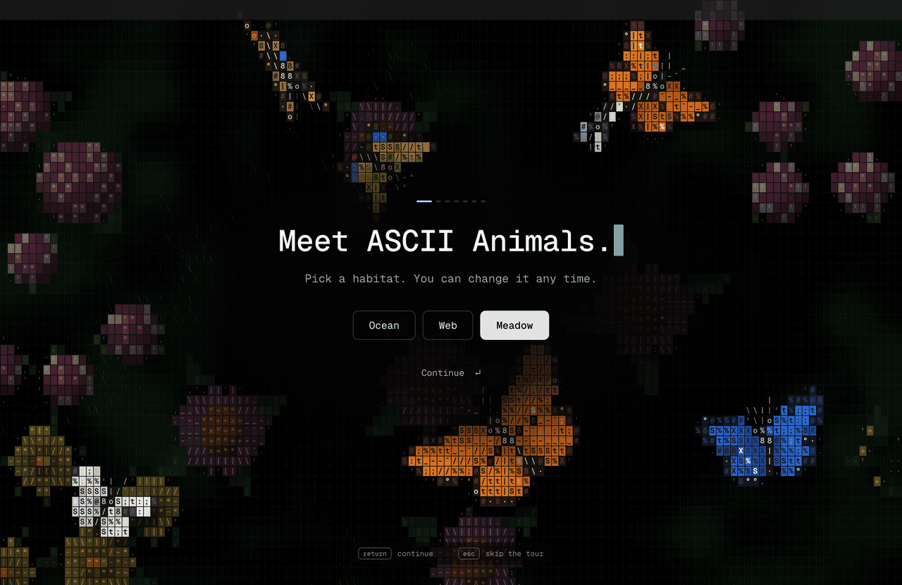 | 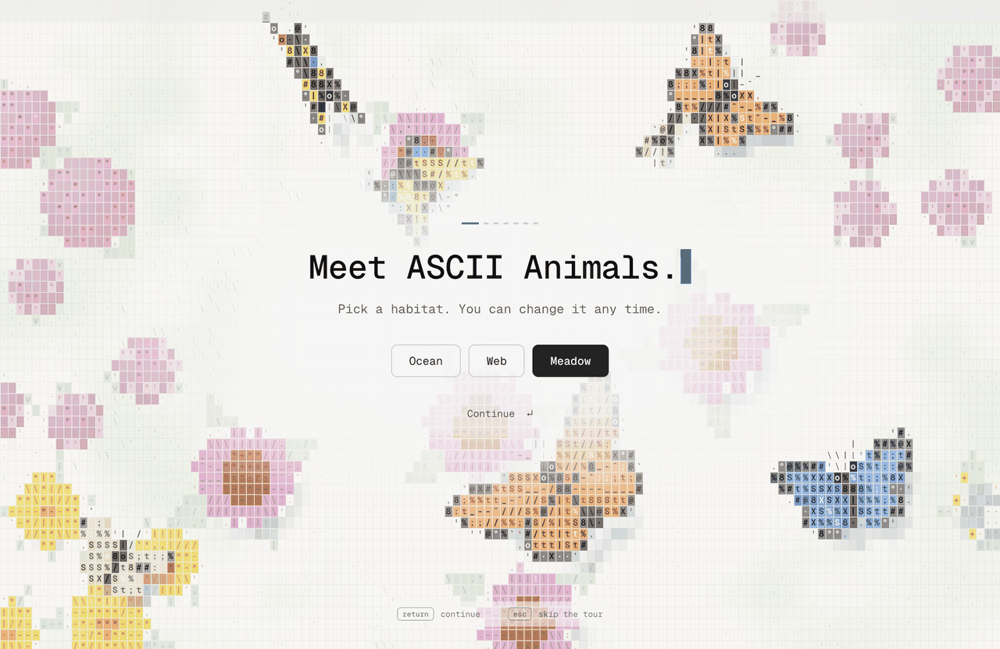 |
| Make it yours, Butterflies row | 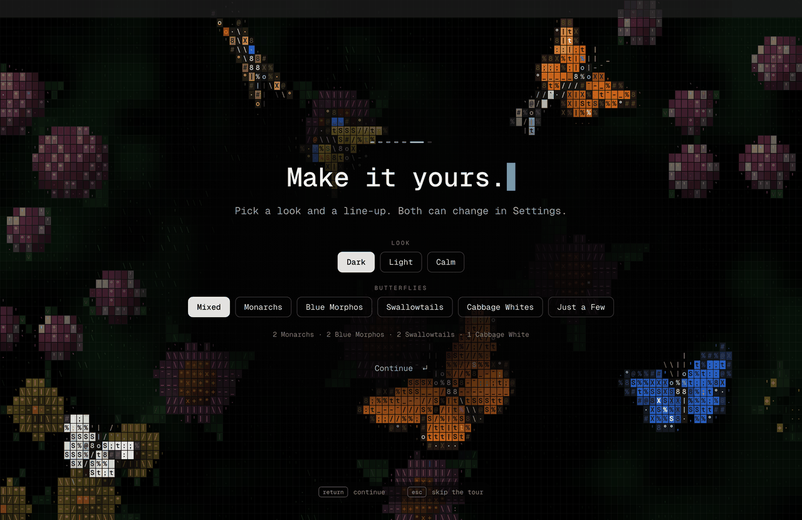 | 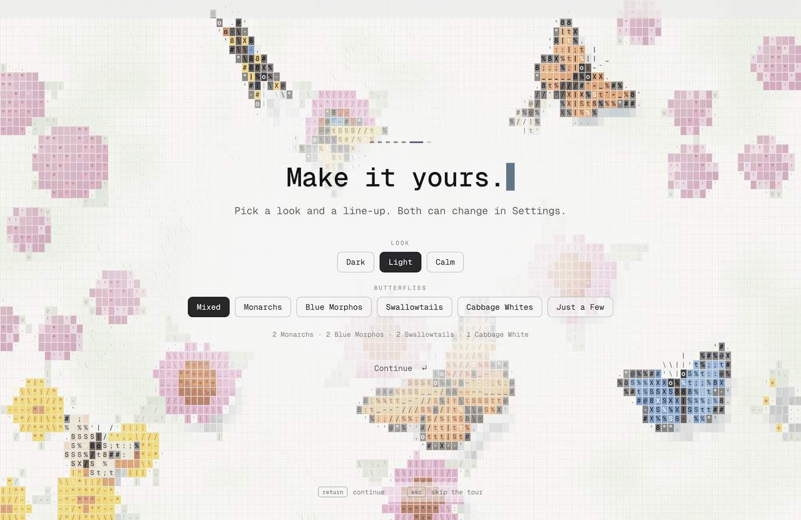 |

## For m8 and t9 (once approved)

- **Settings (m8):** the Meadow keeps the species that are on (in the order Monarch, Blue Morpho, Swallowtail,
  Cabbage White) and a laptop count 1–12; unknown species are dropped; at least one stays on; defaults all four and 7.
  Presets live in `Presets.swift` beside the sharks' and spiders'. Switching line-ups uses the sketch's rule:
  spares leave through the nearest edge, newcomers fly in; nobody pops.
- **Menu, Settings words, status, welcome and the card (t9):** as above. The card's "shown once" decision reuses the
  Web card's pure function, generalised to a habitat, with its own key.

## Questions for the director

1. **Line-ups:** the six above, with "Mixed" as the default's name?
2. **Custom:** the four switches and "How many" in Settings?
3. **What's new:** C, the small card in the welcome's voice?
4. **How many on a big display:** "7 on a laptop", scaled by area, gives about 20 on a 2560 × 1440 display. Were the
   7 tuned on a laptop? If they were tuned on a bigger screen, the laptop number should be lower.
